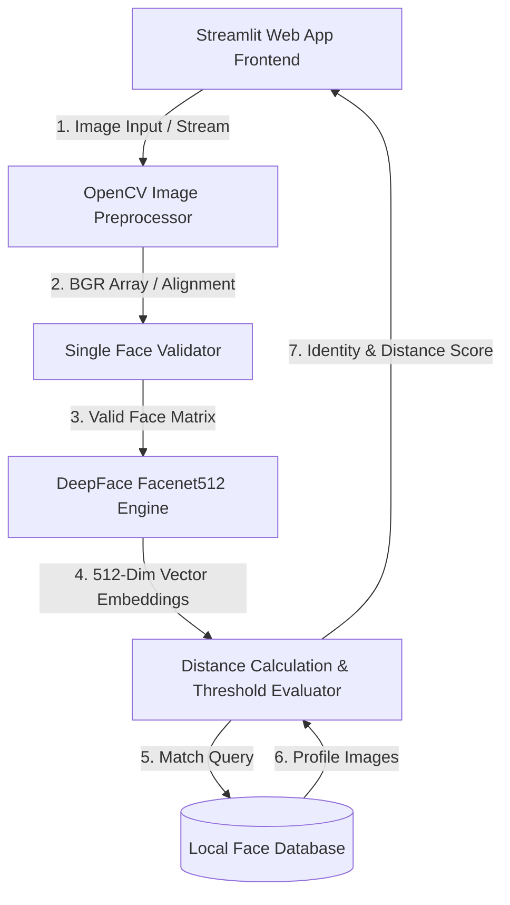
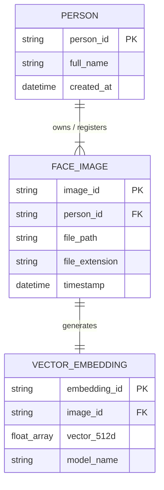
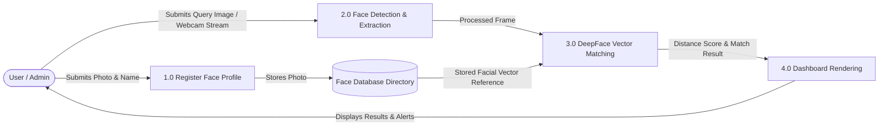

# 👤 Face Recognition Studio

An enterprise-grade, real-time face recognition and user identification web application built with Python, Streamlit, OpenCV, and DeepFace.

---

[](https://www.python.org/)
[](https://streamlit.io/)
[](https://opencv.org/)
[](https://github.com/serengil/deepface)
[](LICENSE)

---

## 📋 Table of Contents

- [Overview & Description](#-overview--description)
- [Key Features](#-key-features)
- [Use Cases](#-use-cases)
- [Prerequisites](#-prerequisites)
- [Setup & Installation](#-setup--installation)
- [Project Folder Structure](#-project-folder-structure)
- [System Architecture](#-system-architecture)
- [Entity-Relationship (ER) Diagram](#-entity-relationship-er-diagram)
- [Data Flow Diagram (DFD)](#-data-flow-diagram-dfd)
- [How To Use](#-how-to-use)
- [Pros, Cons & Limitations](#-pros-cons--limitations)
- [Future Upgrades](#-future-upgrades)
- [Contributing](#-contributing)
- [License & Acknowledgments](#-license--acknowledgments)

---

## 📝 Overview & Description

**Face Recognition Studio** is an interactive, real-time facial recognition dashboard designed to seamlessly bridge deep learning algorithms with a sleek, dark-themed Streamlit user interface. 

By leveraging **DeepFace** with the **Facenet512** vector embedding model and **OpenCV** detection backends, the application extracts high-dimensional facial features, validates single-person identification, computes distance metrics (Cosine/Euclidean), and recognizes individuals instantly via uploaded images or webcams.

---

## ✨ Key Features

- **⚡ Real-Time Face Registration**: Extract and store standardized facial profiles directly into an isolated local storage database.
- **📷 Dual Camera & Upload Support**: Capture frames directly through integrated webcam stream or upload static `.jpg`, `.jpeg`, or `.png` files.
- **🛡️ Validation & Error Guarding**: Automated face detection check ensures that exactly one face is present per registration photo.
- **🔍 Distance Metric Matcher**: Calculates Cosine distance scores using state-of-the-art vector embeddings to minimize false positives.
- **📁 Local Database Explorer**: Built-in dynamic file viewer to inspect registered profiles, count entries, and preview facial datasets.
- **🎨 Trendy Dark Theme UI**: Custom CSS styling crafted for modern, responsive, and intuitive user experiences.

---

## 💼 Use Cases

1. **Smart Attendance Systems**: Automated identity logging for classrooms, offices, and events.
2. **Access Control Management**: Restrict physical or digital workspace entry based on biometric facial matching.
3. **VIP / Visitor Identification**: Real-time alerts for customer relationship management or guest onboarding.
4. **Educational & AI Research**: Ideal prototype demonstration for computer vision and deep learning pipelines.

---

## ⚡ Prerequisites

Ensure your system meets the following software requirements before proceeding:

- **Operating System**: Windows 10/11, macOS, or Linux (Ubuntu 20.04+)
- **Python**: Version `3.10` or higher
- **Hardware**: 
  - Minimum: 8 GB RAM, Dual-Core CPU
  - Recommended: 16 GB RAM, NVIDIA GPU (CUDA enabled for accelerated vector processing)
- **Webcam**: Integrated or external USB camera (if live frame capture is needed)

---

## 💻 Setup & Installation

Follow these step-by-step terminal instructions to configure the environment:

### 1. Clone or Create the Repository
```bash
git clone https://github.com/alok-kumar8765/FaceRecognitionApp.git
cd FaceRecognitionApp
```

### 2. Create a Virtual Environment
```bash
# Windows
python -m venv venv

# macOS / Linux
python3 -m venv venv
```

### 3. Activate Virtual Environment
```bash
# Windows (Command Prompt)
venv\Scripts\activate

# Windows (PowerShell)
.\venv\Scripts\Activate.ps1

# macOS / Linux
source venv/bin/activate
```

### 4. Upgrade Pip & Install Dependencies
```bash
python -m pip install --upgrade pip
pip install streamlit deepface opencv-python pandas tf-keras
```

---

## 📂 Project Folder Structure

```text
FaceRecognitionApp/
├── app.py                  # Main Streamlit web application script
├── README.md               # Project documentation
├── requirements.txt        # Python dependency specifications
└── face_database/          # Root directory for face storage
    ├── Akash/              # User subfolder containing enrolled face frames
    │   ├── face_1.jpg
    │   └── face_2.jpg
    └── Riya/               # User subfolder containing enrolled face frames
        ├── face_1.jpg
        └── face_2.jpg
```

---

## 🏗️ System Architecture

The overall system architecture follows a modular pipeline separating UI interactions, preprocessing, feature extraction, database matching, and feedback generation.



---

## 🗂️ Entity-Relationship (ER) Diagram

Below is the logical data entity representation governing user registration and profile data storage.



---

## 🔄 Data Flow Diagram (DFD)

### Level 1 Data Flow Diagram


---

## 🚀 How To Use

1. **Launch the Application**:
   ```bash
   streamlit run app.py
   ```
2. **Access Web Portal**:
   Open your browser and navigate to `http://localhost:8501`.
3. **Register New Faces**:
   - Go to **📝 1. Register Face** tab.
   - Enter person's name and upload a single clear facial photo.
   - Click **Register Face**.
4. **Recognize Faces**:
   - Navigate to **🔍 2. Recognize Face** tab.
   - Choose input source: **Webcam** or **Upload Image**.
   - Click **Verify Match** to execute face matching logic.
5. **Explore Database**:
   - Switch to **📁 3. Local Database** tab to view currently indexed profiles and facial captures.

---

## ⚖️ Pros, Cons & Limitations

### 🟢 Pros
- Fast execution with responsive web dashboard interface.
- Local execution guarantees data privacy and offline operational capability.
- Compatible with various DeepFace detection backends (`opencv`, `retinaface`, `mtcnn`).

### 🔴 Cons & Limitations
- **Processing Overhead**: Heavy deep learning models (`Facenet512`) might experience latency on lower-end CPU hardware.
- **Lighting Sensitivity**: Poor lighting or heavily obstructed faces may decrease accuracy.
- **Local Storage Scope**: Default setup stores data locally on disk rather than an isolated external cloud server.

---

## 🔮 Future Upgrades

- [ ] **Multi-Face Detection**: Support simultaneous recognition of multiple individuals in a single frame.
- [ ] **Liveness Detection**: Integrate anti-spoofing algorithms to prevent photo-replay attacks.
- [ ] **Vector Database Integration**: Implement Milvus, Qdrant, or FAISS for handling millions of face embeddings efficiently.
- [ ] **Cloud Database Synchronization**: Sync user images with AWS S3 or Google Cloud Storage bucket.

---

## 🤝 Contributing

Contributions, issues, and feature requests are welcome!

1. Fork the Project Repository.
2. Create your Feature Branch (`git checkout -b feature/AmazingFeature`).
3. Commit your Changes (`git commit -m 'Add some AmazingFeature'`).
4. Push to the Branch (`git checkout -b feature/AmazingFeature`).
5. Open a Pull Request.

---

## 📜 License & Acknowledgments

This project is open-source and released under the **MIT License**.

**Special Thanks to:**
- [DeepFace Library](https://github.com/serengil/deepface) by Sefik Ilkin Serengil.
- [Streamlit Framework](https://streamlit.io/) for seamless Python web app deployments.
- [OpenCV Community](https://opencv.org/) for real-time computer vision utilities.